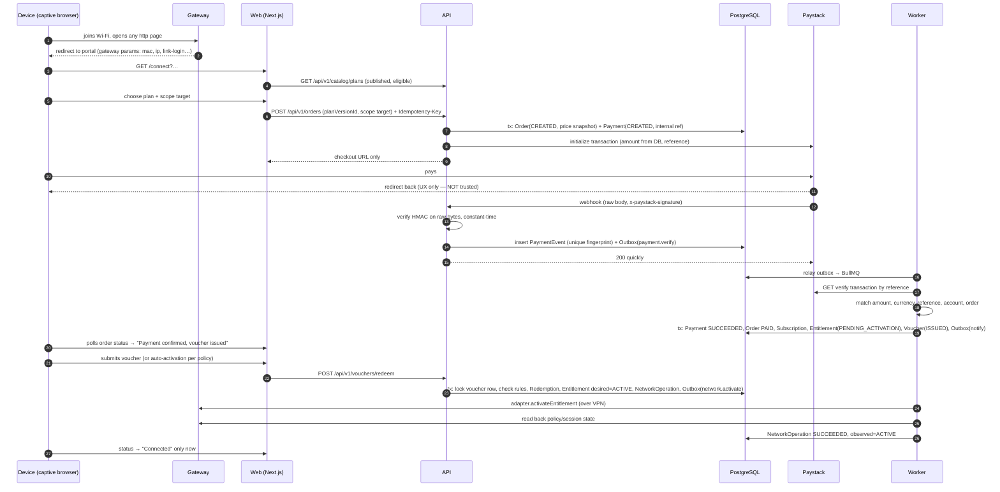
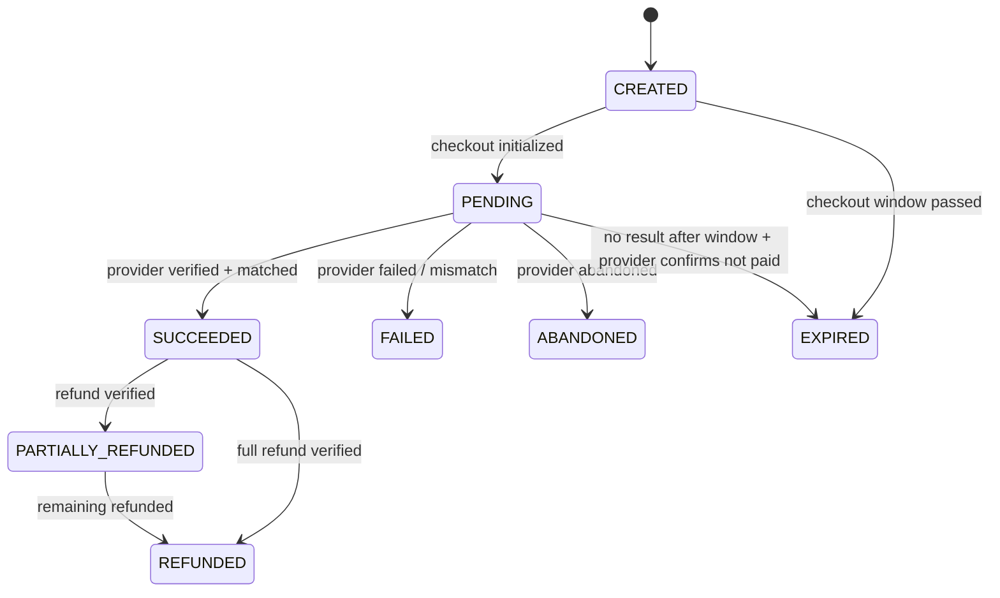
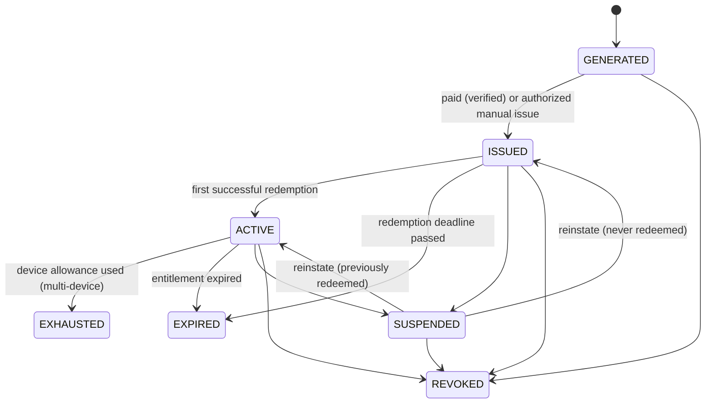
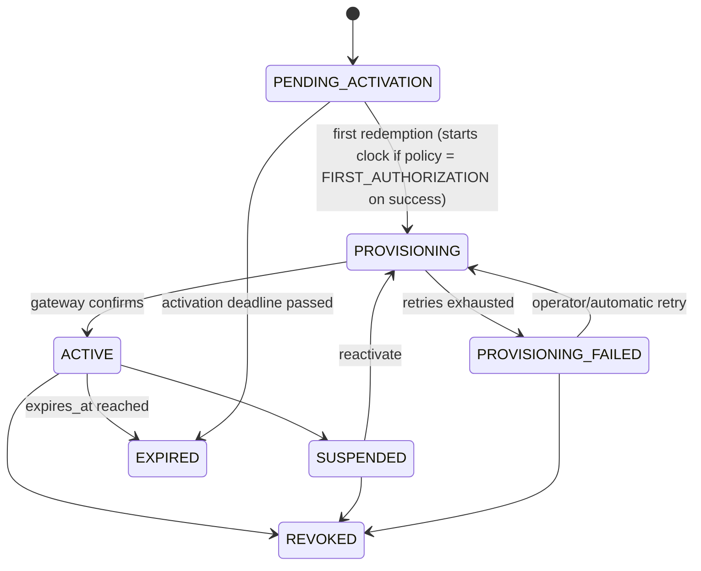

# NetFlex — Data Flows and State Machines

Status: **Proposed** (Phase 0). Final activation policy and group rules need owner approval (see owner-decisions.md).

## 1. Purchase → access (happy path)



Failure branches:

- **Webhook never arrives:** the reconciliation job verifies `PENDING` payments older than N minutes directly with the provider. The return page can also trigger a server-side verify (it still never trusts the browser's status).
- **Amount/currency/reference mismatch:** payment → `FAILED` with discrepancy record, operator alert, no voucher.
- **Provisioning fails:** order stays `PAID`; entitlement `PROVISIONING_FAILED`; bounded retries with backoff + jitter; operator alert; tenant sees "Access being configured — we're on it" + support path. Never re-charge.
- **Duplicate/out-of-order webhook:** unique event fingerprint stops re-processing; state machine rejects backwards transitions (e.g. `SUCCEEDED` → `PENDING`).

## 2. Admin-issued voucher

`POST /api/v1/admin/vouchers` (permission `voucher.issue`) → Voucher with `issuanceType ∈ {COMPLIMENTARY, MANUAL, PROMOTIONAL}`, `issuedById`, `reason` mandatory → AuditLog. No Payment record is created, so reports never count it as revenue. Bulk issue needs explicit confirmation, a hard cap, and a one-time export.

## 3. Expiry and revocation

```mermaid
flowchart LR
  T[Scheduled expiry job<br/>every minute + per-entitlement delayed job] --> Q{expires_at <= now()?}
  Q -- yes --> E[tx: Entitlement EXPIRED<br/>Outbox network.revoke]
  E --> R[Worker: adapter.revokeEntitlement + disconnectSession]
  R --> V[Read back: no active sessions/identity]
  V --> OK[NetworkOperation SUCCEEDED]
  V -- mismatch --> DR[Drift record + retry + alert]
```

Two layers: the gateway itself enforces remaining time where supported (e.g. RADIUS `Session-Timeout` or HotSpot `limit-uptime`), and NetFlex reconciles. If the gateway is unreachable, the operation stays pending and retries; access history is not rewritten.

## 4. Cloud outage behaviour (to be proven in PoC, spec §25)

| Situation                                             | Proposed policy (needs owner approval + PoC proof)                                                                                                 |
| ----------------------------------------------------- | -------------------------------------------------------------------------------------------------------------------------------------------------- |
| Starlink/cloud unreachable, client already authorized | Session continues until the gateway-side timeout that was set at activation.                                                                       |
| Cloud unreachable, new activation                     | **Fail closed.** Portal (if reachable) shows "Activation temporarily unavailable". No offline vouchers by default.                                 |
| Gateway unreachable, cloud fine                       | Payments still accepted (if owner allows) with clear "access will start when the network is back" notice; or purchases paused. **Owner decision.** |

## 5. State machines

### 5.1 Payment



A late `success` for an `EXPIRED`/`ABANDONED` payment is **not** auto-applied: it raises a reconciliation discrepancy for an operator (money was taken; decide fulfil vs refund).

### 5.2 Voucher



"Voucher activated" (ACTIVE) is distinct from "redeemed by a device" (a `VoucherRedemption` row). `EXHAUSTED` blocks _new_ devices only; already-bound devices continue until expiry. Reissue = revoke old + issue new linked by `replacesVoucherId`.

### 5.3 Entitlement



## 6. Scope enforcement (data side)

- An Entitlement has exactly one of `{ userId }` (INDIVIDUAL), `{ roomId }` (ROOM), `{ floorId }` (FLOOR) — enforced by a CHECK constraint.
- ROOM/FLOOR entitlements list members via `GroupMembership` (explicit, audited, added by an authorized group manager/admin). Knowing the code is not membership.
- Purchase of a ROOM/FLOOR plan requires purchaser authority recorded for that room/floor (`GroupAuthority`), granted by a property admin.
- Network side of scope (per-zone VLAN/SSID vs per-identity) depends on topology — **blocked on U3/U4**.
