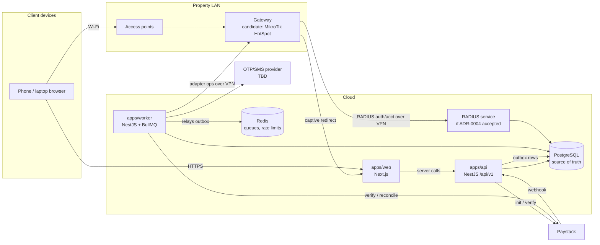

# NetFlex — Architecture Overview

Status: **Proposed** (Phase 0). Nothing here is implemented yet.

## 1. Shape of the system

A **modular monolith plus a worker**, not microservices (spec §3.17, §6). One property today, more later.

## 2. Deployables

| App                  | Responsibility                                                                                                                                                                                        | Scales/restarts independently |
| -------------------- | ----------------------------------------------------------------------------------------------------------------------------------------------------------------------------------------------------- | ----------------------------- |
| `apps/web`           | Next.js App Router. Three route groups: `(marketing)`, `(portal)` captive + tenant, `(admin)`. Server components talk to the API; no secrets in the browser bundle.                                   | yes                           |
| `apps/api`           | NestJS REST `/api/v1`, OpenAPI, auth, RBAC, validation, webhooks (raw body), outbox writes. Never calls the router synchronously in a request.                                                        | yes                           |
| `apps/worker`        | NestJS application context. Outbox relay, BullMQ processors: provisioning, revocation, expiry, reminders, payment reconciliation, webhook processing, network reconciliation, health checks, cleanup. | yes                           |
| RADIUS (conditional) | Only if ADR-0004 is accepted after hardware PoC. Likely FreeRADIUS calling NetFlex over an internal authenticated endpoint, or a small Node RADIUS service.                                           | yes                           |

## 3. Packages

| Package                 | Contents                                                                                                                            |
| ----------------------- | ----------------------------------------------------------------------------------------------------------------------------------- |
| `packages/config`       | zod env schema; fail-fast in production; environment guard that refuses simulators in production                                    |
| `packages/domain`       | Framework-free domain logic: money, time/expiry, voucher codes, state machines, scope rules, pricing. The most heavily tested code. |
| `packages/database`     | Prisma schema, migrations, seed (demo data, dev only), DB-level constraints written as SQL in migrations                            |
| `packages/shared-types` | API DTO types and the response envelope `{ data, error: { code, message }, meta }`                                                  |
| `packages/validation`   | zod schemas shared by web forms and API                                                                                             |
| `packages/payments`     | `PaymentProvider` interface, `PaystackProvider`, `FakePaymentProvider` (test-only)                                                  |
| `packages/network`      | `NetworkAdapter` interface, capability model, `FakeNetworkAdapter` (test-only), `MikrotikAdapter` (not live-verified until PoC)     |
| `packages/ui`           | Design tokens (CSS custom properties), primitives: type scale, table, form fields, inline status, dialog                            |

## 4. Key architectural rules

1. **PostgreSQL is the truth.** Redis holds queues and rate-limit counters only; losing Redis loses no business state — the outbox re-drives work.
2. **Transactional outbox.** Any DB transaction that needs follow-up work (provision, revoke, notify) inserts an `OutboxEvent` in the same transaction. The worker claims rows with `SELECT … FOR UPDATE SKIP LOCKED`, enqueues to BullMQ with `jobId = outboxEvent.id`, marks dispatched. A crash between commit and enqueue just means the row is relayed later.
3. **Idempotency everywhere it matters.** Unique constraints on provider references, webhook event fingerprints, `(orderId)` → one subscription, `(subscriptionId)` → one paid voucher, `NetworkOperation.idempotencyKey`.
4. **Separate aggregates** (spec §8.5): Order, Payment, Voucher, Subscription, Entitlement, NetworkSession. A voucher never stores payment truth; a session never stores entitlement truth.
5. **Desired vs actual.** Entitlements hold _desired_ network state; `NetworkOperation` and reconciliation record _observed_ state. "Connected" is only shown when observed state matches and a client session is seen (spec §12).
6. **Time.** All timestamps `timestamptz` in UTC. Expiry uses DB time (`now()`), is **exclusive** (access valid while `now < expires_at`), computed once and persisted. Display uses the property's IANA time zone (default `Africa/Lagos`, no DST).
7. **Money.** `bigint` minor units + ISO currency (`NGN` → kobo). No floats. Price always computed server-side from an immutable `PlanVersion`.
8. **Simulators are fenced.** Fake payment/network adapters live in packages that the production DI module refuses to register when `NETFLEX_ENV=production`; config validation fails startup if a simulator flag is set in production.
9. **Management path.** No public inbound router access. The gateway dials out to a WireGuard hub (Starlink is usually CGNAT); the worker reaches the router API over that tunnel only. Browsers can never choose a gateway, IP, or command.
10. **Authorization in services and queries,** not in the UI. Every query is scoped by property and by actor permissions; deny by default.

## 5. Module map (API)

`auth` · `users` · `rbac` · `properties` (property/building/floor/room/zone) · `tenancy` (assignments, groups) · `catalog` (plans, versions) · `orders` · `payments` (+ webhooks, refunds, reconciliation) · `vouchers` · `subscriptions` · `entitlements` · `network` (gateways, operations, sessions) · `notifications` · `support` · `audit` · `settings` · `health`.

## 6. Technology rationale

| Choice                          | Why                                                                                                                   |
| ------------------------------- | --------------------------------------------------------------------------------------------------------------------- |
| npm workspaces                  | Spec preference; no existing manager to preserve                                                                      |
| Next.js App Router              | Spec baseline; server rendering keeps the captive portal light on weak links                                          |
| NestJS                          | Spec baseline; modules, guards, interceptors map well to RBAC/audit/correlation IDs                                   |
| Prisma                          | Spec baseline; raw SQL migrations added for CHECK/partial-unique constraints Prisma can't express                     |
| BullMQ                          | Durable retries with backoff, inspection, replay; justified because provisioning/reconciliation must survive restarts |
| zod                             | One schema language for env, forms, and API DTOs (with a Nest validation pipe)                                        |
| Vitest + Supertest + Playwright | Unit/integration, API, and E2E/UI respectively                                                                        |
| pino                            | Structured JSON logs with redaction paths and correlation IDs                                                         |

See ADRs in [`docs/decisions/`](../decisions/).
